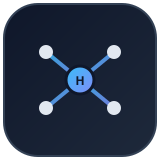

<div align="center">
  
  <h1>hyperresearch-opencode</h1>
  <p><strong>Deep research in OpenCode — in any session, from any directory.</strong></p>
  <p>
    
    
    
    
  </p>
</div>

---

## Why this exists

[hyperresearch](https://github.com/jordan-gibbs/hyperresearch) is a deep
research harness: a 16-step pipeline with adversarial critics, citation
verification and a persistent markdown/SQLite vault. It officially targets
Claude Code and OpenAI Codex.

This repository renders that same pipeline into **native OpenCode skills,
subagents, commands and configuration**. It does not fork or patch the upstream
project — it reads the files the official CLI already generates and translates
them. The result is a global skill: ask for deep research in any OpenCode
session and the router takes over instead of answering inline.

## At a glance

| | |
|---|---|
| Entry point | `/hyperresearch <question>`, `@hyperresearch`, or a plain deep-research prompt |
| Scope | Global (`~/.config/opencode`) or project-local (`.opencode/`) |
| Skills | 19 — router + 18 step procedures |
| Subagents | 16 — native OpenCode subagents with permission rules |
| Vault | Created per project on first use, under `research/` |
| Deliverable | `research/notes/final_report_<vault_tag>.md` |
| Gate | `hyperresearch run finish <vault_tag>` must report `passed: true` |

## Requirements

- Python 3.11+
- OpenCode V2
- A working hyperresearch install with its CLI and generated agent files:

  ```powershell
  pip install hyperresearch
  cd path\to\your\hyperresearch\repo
  hyperresearch install . --target all --json
  ```

  Use `pip install git+https://github.com/jordan-gibbs/hyperresearch` if you need
  the GitHub revision rather than the current PyPI release.

## Install

From this repository:

```powershell
python build_opencode.py --scope global --repo F:/hyperresearch-skill
python test_opencode.py --repo F:/hyperresearch-skill --scope global
```

`--repo` can be replaced with the `HYPERRESEARCH_REPO` environment variable,
and is detected automatically when the adapter is run from inside a
hyperresearch checkout.

Then run `/reload` in OpenCode, or start a new session. OpenCode watches config
files, but a skill body already loaded into a session stays cached until reload.

### Project-local scope

```powershell
python build_opencode.py --scope project --repo F:/hyperresearch-skill --project F:/my-project
```

This writes `F:/my-project/.opencode/` plus `opencode.jsonc` and an `AGENTS.md`
section. Both scopes can coexist; project skills win by ID.

## Use it

From any directory:

```text
/hyperresearch <your research question>
```

Or ask for deep research, a literature review, a multi-source analysis, or a
cited report. `@hyperresearch` loads the router explicitly.

On first use in a directory the bootstrap creates `.hyperresearch/` and
`research/` there. Run artifacts live under `research/runs/<vault_tag>/`.

## How the translation works

| Upstream / Claude Code | OpenCode |
|---|---|
| `Skill(skill: "x")` | `skill(id: "x")` |
| `Task` subagent dispatch | `subagent` tool (`agent`, `description`, `prompt`) |
| `TodoWrite` | `todowrite` (via `experimental.todo`) |
| `Read` / `Write` / `Edit` / `Bash` | `read` / `write` / `edit` / `shell` |
| `WebSearch` / `ToolSearch` | `websearch` / the native tool catalog |
| Claude-in-Chrome MCP fetcher | OpenCode Desktop `browser` namespace via `execute` |
| Bash `for` / `test -f` loops | `artifact_gate.py` / `patch_skip_log.py` |

The global config merge preserves existing MCP servers, providers, plugins and
other settings; it only adds the adapter's permissions, `todo` flag and
instructions path.

## Repository layout

| File | Role |
|---|---|
| `build_opencode.py` | Renderer — `--scope global\|project`, `--repo`, `--project`, `--global-dir` |
| `test_opencode.py` | Structural, config, translation and CLI smoke tests |
| `artifact_gate.py` | Cross-platform replacement for the upstream bash artifact check |
| `patch_skip_log.py` | Cross-platform replacement for the upstream `python -c` skip-log snippet |
| `OPENCODE_INSTRUCTIONS.md` | Generated routing block registered in the global config |
| `assets/logo.svg` | Project mark |

## Tests

```powershell
python build_opencode.py --scope global --repo F:/hyperresearch-skill
python test_opencode.py --repo F:/hyperresearch-skill --scope global
python build_opencode.py --scope project --repo F:/hyperresearch-skill --project F:/hyperresearch-skill
python test_opencode.py --repo F:/hyperresearch-skill --scope project --project F:/hyperresearch-skill
```

`test_opencode.py` checks all skill IDs and subagent definitions, frontmatter,
config merging, CLI path correctness, absence of stale Claude-only tokens, and
boots a vault in a temporary directory to prove the CLI works outside the
hyperresearch repo. A GitHub Actions workflow runs syntax, import and helper
script smoke checks.

For the upstream package itself, in the hyperresearch repo:

```powershell
python -m pytest tests/ -q
```

## Known limitations

- OpenCode's `edit` permission also covers `write`, so "Edit-only" subagents
  cannot be strictly prevented from writing. Permissions still block shell,
  web and nested subagents for those roles, and the prompt states the
  patch-only discipline.
- OpenCode has no documented Stop hook equivalent. The router instructs the
  orchestrator not to end the turn while background subagents are running;
  `hyperresearch run finish` is the real gate.
- Subagents inherit the session model; Claude profile model pins are not
  carried over.
- The browser escalation lane needs OpenCode Desktop with a browser attached.
  Otherwise blocked URLs stay queued and are reported to the user.
- Generated files contain an absolute CLI path. Re-run the adapter if the
  hyperresearch install moves, and re-run `hyperresearch install` plus the
  adapter after any profile/gear change.

## Contributing

See [CONTRIBUTING.md](CONTRIBUTING.md).

## License

MIT — see [LICENSE](LICENSE). The upstream hyperresearch project is also MIT
licensed. This repository contains no upstream source code, only derived
OpenCode configuration and the adapter that produces it.
